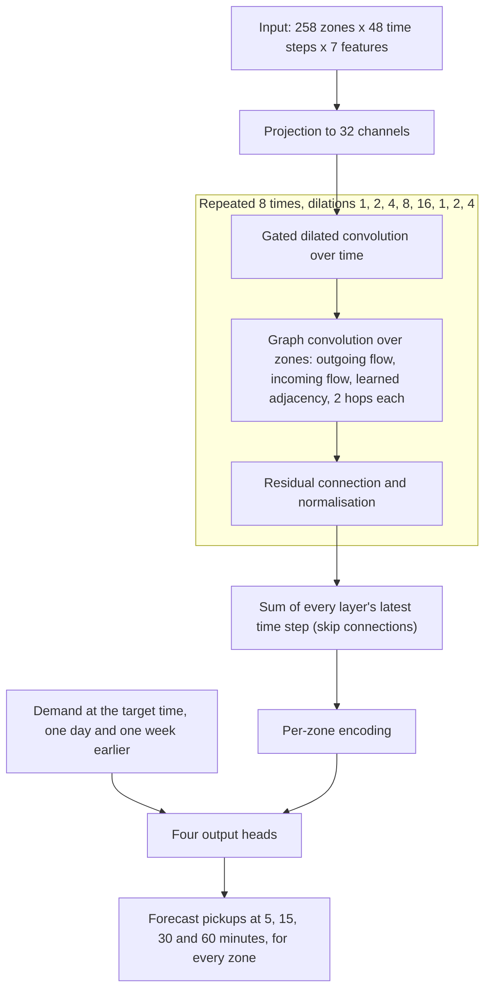
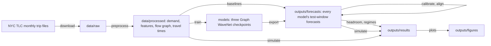

# SurgeMap: forecasting taxi demand across a city

A walkthrough of the project for presentation: the problem, how it is usually solved and where those
approaches fall short, the approach taken here, and the system built around it.

---

## 1. The problem

A taxi or ride-hailing fleet earns nothing from a vehicle that is in the wrong place. If demand rises in one
part of the city while idle vehicles sit in another, riders wait or give up, and drivers burn fuel driving
empty. The operator can only move vehicles ahead of time if it knows where demand is about to appear.

**The task.** Forecast how many taxi pickups each zone of New York City will see over the next 5, 15, 30 and 60
minutes.

| | |
|---|---|
| Data | NYC yellow-taxi trip records, October 2023 to January 2024: about 13 million trips |
| Space | 258 taxi zones |
| Time | 5-minute bins: 35,424 time steps |
| Input to a forecast | the last 4 hours (48 bins) for every zone |
| Output | pickups per zone at 5, 15, 30 and 60 minutes ahead |
| Held-out test | 27 to 31 January 2024, never used for fitting |

**Why it is hard.**

- **Demand is a count, and mostly small.** In 80% of zone-and-bin cells there is no pickup at all. Individual
  pickups arrive at random, so part of the error can never be removed.
- **Demand moves in time and in space at once.** A zone's next hour depends on its own recent past, on the time
  of day and week, and on what is happening in other zones.
- **Zones differ enormously.** The busiest 30 of the 258 zones account for 81% of all pickups; an airport, a business
  district and a residential area follow different rhythms.

---

## 2. How this is usually solved

| Approach | How it works | Where it falls short |
|----------|--------------|----------------------|
| **Persistence** | The next value equals the last one | Ignores every pattern; error grows quickly with the horizon |
| **Historical average** | The average for this zone at this time of day and day of week | Knows the routine, blind to what is happening right now |
| **Classical time-series models** (ARIMA and relatives) | Each zone is forecast from a weighted sum of its own recent values | One zone at a time, no information from other zones; assumes smooth, roughly normal values, which small counts are not |
| **Regression on lagged values** (ridge) | A linear model on each zone's last 48 bins | Only straight-line relationships; a separate model per zone, so nothing is shared between zones |
| **Gradient-boosted trees** | One model for all zones, on hand-built features: recent values, same time yesterday and last week, calendar, weather | Strong and cheap, but every feature must be designed by hand, and relations between zones exist only if someone writes them in as features |
| **Recurrent networks per zone** (LSTM, GRU) | A sequence model reads each zone's history | Learns temporal patterns well, but still treats every zone as if it were alone |
| **Convolutional networks on a map grid** | The city is cut into a square grid and treated as an image | Taxi zones are irregular shapes, and related zones are often far apart: an image filter only sees neighbours |

**The common gap.** Each approach handles time, or space, or neither, but rarely both together. The two that
come closest have their own limits: boosted trees see other zones only through features a person thought of,
and grid convolutions assume that "related" means "next to each other on the map".

---

## 3. The approach: a spatio-temporal graph neural network

The city is modelled as a **graph**. Each zone is a node, and an edge between two zones says that what happens
in one tells you something about the other. A network then learns two things together:

- a **temporal** part that reads each zone's recent history, and
- a **spatial** part that lets zones exchange what they have learned over the graph.

The shipped network is a **Graph WaveNet** (after Wu et al., 2019). The forecast is the average of three such
networks trained from different random starts.

### 3.1 The temporal part

**Why it is needed.** A zone's demand in the next hour is shaped by what it has been doing: whether it is
rising or falling, where it is in its daily cycle, and how today compares with a normal day.

**The patterns it is there to capture.**

| Pattern | Example |
|---------|---------|
| Short-term momentum | Demand has climbed for the last 20 minutes and is likely to keep climbing |
| The daily cycle | Morning and evening peaks, the quiet hours before dawn |
| The weekly cycle | A Friday night differs from a Tuesday night |
| Departures from routine | A zone is running at twice its usual level for this hour |

**How it is done.**

- **Dilated convolutions over the 4-hour window.** Eight layers look at time steps 1, 2, 4, 8 and 16 bins
  apart. The early layers see fine detail (the last few minutes); the later layers see slow change (the last
  hours). Together they cover the window, and every part of it is read directly, so older steps are not
  forgotten the way a step-by-step recurrent network tends to forget them.
- **Gates.** Each layer has a gate that decides how much of its signal to pass on, which lets the network ignore
  history that is irrelevant at a given moment.
- **Calendar inputs.** Time of day and day of week are given as smooth cyclic features, so 23:55 and 00:00 are
  understood to be adjacent.
- **Yesterday and last week.** For each forecast, the network is also given the demand at that same target time
  one day and one week earlier. Four hours of history cannot show a weekly rhythm; these two inputs supply it.

### 3.2 The spatial part

**Why it is needed.** Zones are not independent. A vehicle that drops a passenger in one zone is a pickup
waiting to happen there or nearby; a concert ending affects the zones around the venue; business districts
empty together.

**The patterns it is there to capture.**

| Pattern | Example |
|---------|---------|
| Demand that travels | Arrivals at an airport become pickups in the hotel districts a little later |
| Spillover | When one zone is saturated, riders walk to the next |
| Zones that move together | Two business districts far apart both peak at 18:00 |
| Events wider than one zone | Rain or a public event shifts demand across a whole area |

**How it is done.** After every temporal layer, a graph convolution updates each zone using its neighbours'
states. "Neighbour" is defined by three graphs at once:

| Graph | What it says | Built from |
|-------|--------------|------------|
| Outgoing flow | Where trips from this zone go | Pickup-to-dropoff counts |
| Incoming flow | Where trips into this zone come from | The same counts, reversed |
| Learned adjacency | Which zones behave alike, wherever they are | Learned during training from two small vectors per zone |

- **Flow, not map distance.** The first two graphs connect zones by how many trips actually run between them,
  so two distant zones linked by heavy traffic count as close. Because most trips are short, this graph also
  contains most of what simple geographic adjacency would add.
- **A graph the network writes itself.** The third graph is not given. The network discovers which zones are
  useful to each other for forecasting, which covers relationships with no trips behind them, such as two
  similar districts on opposite sides of the city.
- **Two hops per layer.** Each graph convolution reaches neighbours and neighbours of neighbours, so over eight
  layers information can cross the city.
- **Recent dropoffs as an input.** Each zone's dropoff count is one of the input features: passengers arriving
  now are a direct sign of where vehicles, and soon demand, will be.

### 3.3 How the two parts fit together

Temporal and spatial layers alternate. This is the central difference from the project's first design, which
mixed zones once on the raw inputs and then read each zone's history separately. Alternating lets a zone pass on
what it has *worked out* (for example "I am in the early stage of a surge"), not only its raw counts.

One network has 147,644 parameters.

### 3.4 Training choices that mattered

| Choice | Why |
|--------|-----|
| **Poisson loss on pickup counts** | Demand is a count; training on squared error of a log-transformed value under-predicted total volume by 8 to 12% |
| **Shuffled training windows** | Consecutive windows are nearly identical; feeding them in order made the network fit poorly. This was the largest single gain from the recipe |
| **Four months of history** | One month is too short to learn a weekly pattern reliably |
| **Averaging three networks** | Removes the luck of one random initialisation |
| **Calibration on the validation days** | A small per-zone correction, fitted only on data the model was not trained on and applied identically to the strongest baseline |

---

## 4. Results

Error is RMSE in pickups per zone per 5-minute bin on the held-out test window; lower is better. Every fitted
model was trained on the same four months.

| Model | 5 min | 15 min | 30 min | 60 min |
|-------|-------|--------|--------|--------|
| **ST-GNN (Graph WaveNet), calibrated** | **1.326** | **1.386** | **1.406** | **1.421** |
| Gradient boosting, calibrated | 1.358 | 1.423 | 1.447 | 1.471 |
| Ridge regression | 1.428 | 1.535 | 1.626 | 1.769 |
| Historical average | 1.544 | 1.545 | 1.547 | 1.553 |
| Persistence | 1.716 | 1.889 | 2.016 | 2.189 |

- **Most accurate at every horizon.** The network is 23 to 35% better than persistence, 7 to 19% better than
  ridge regression, and 2.4 to 3.4% better than calibrated gradient boosting (3.3 to 5.9% before calibration).
  Every 95% confidence interval excludes zero.
- **Its error barely grows with the horizon**, from 1.33 at 5 minutes to 1.42 at 60, while ridge and
  persistence degrade quickly.
- **The lead is largest when it matters.** In the 5% of periods where citywide demand is furthest above normal,
  the network is 4 to 7% more accurate than gradient boosting, against about 2% in ordinary periods. Nearly all
  of the lead is in the busiest zones.
- **There is a floor.** Because pickups arrive at random, even a perfect model of the demand rate would score
  about 1.16. The network is 14% above that floor at 5 minutes and 22% at 60.
- **The architecture earned its place.** Replacing the first design (one graph convolution, then a GRU) with
  Graph WaveNet improved accuracy by a further 1 to 2%. Making the first design wider or deeper had done nothing.

---

## 5. From forecast to decision: repositioning

A forecast is only useful if it changes a decision, so the project also tests one.

- **Simulator.** Real pickups from the test window are replayed against a simulated fleet. A rider is served by
  an idle vehicle in the same zone, or by the nearest one that can arrive within 15 minutes; otherwise the
  request is lost.
- **Policy.** Every 15 minutes a small linear program decides how many idle vehicles to send from which zone to
  which, using the forecast. It weighs rider waiting against the cost of driving empty.
- **Study.** Policies driven by each forecaster, and by the true future demand as an upper bound, are compared
  over several fleet sizes and random seeds.

**What it showed.**

- Repositioning on a forecast clearly helps: with 2,000 vehicles, unmet requests fall from 42.8% to about 26%
  and average wait from 7.6 to about 5.3 minutes.
- A poor forecaster costs riders: the ridge-driven policy leaves about 5 to 8% more wait than the ST-GNN-driven
  one at 2,000 to 3,000 vehicles.
- Beyond a good forecast, more accuracy stops paying off: the ST-GNN and gradient boosting are indistinguishable
  as policies. Even knowing the true future demand gains little more, because the limit becomes the fleet and
  the travel times, not the forecast.

The fleet is synthetic, since public data has no vehicle positions, so this compares policies with each other
and is not a prediction of real-world performance.

---

## 6. System architecture

Everything is one Python package, `surgemap`, with one command per stage. Each stage reads files written by the
one before it, so any stage can be rerun without repeating the others.

| Part of the package | Responsibility |
|---------------------|----------------|
| `surgemap/data` | Download the trip files; turn trips into 5-minute counts per zone, input features, the flow graph and zone-to-zone travel times; build training windows |
| `surgemap/models` | Graph WaveNet, the first GRU-based design, and the baselines |
| `surgemap/training` | The training loop, the Poisson loss, early stopping |
| `surgemap/evaluation` | Loading checkpoints and producing forecasts, calibration, error metrics, bootstrap confidence intervals, and the analyses by period and by zone |
| `surgemap/simulation` | The fleet simulator, the repositioning policy, the comparison study and its plots |

**Design decisions.**

- **Training and everything else are separated by files.** Training needs a GPU; forecasts are saved once, and
  every analysis and simulation then runs on a laptop from those saved forecasts.
- **Every model is scored the same way.** All forecasters write into one file in the same units (pickup counts)
  for the same forecast times, so no comparison depends on a model-specific code path.
- **Results are reproducible.** Random seeds are fixed, the test window is never used for fitting, and the
  shipped networks reproduce the shipped numbers exactly when rerun.
- **The code is tested.** 99 automated tests cover the data pipeline, the models, the metrics, the simulator and
  the policy.

---

## 7. Limitations

- **One city, one season, a five-day test window.** Four months do not show how the model copes with summer, or
  with a different city.
- **The lead over a well-tuned gradient-boosted model is modest**, a few percent, because most of the remaining
  error is randomness that no model can predict.
- **The graph's own contribution is not isolated.** Graph WaveNet changed the temporal and the spatial design
  together, and the shipped network has not been retrained without its graph. In the first design the graph was
  worth about 1% or less.
- **The architecture and recipe were chosen while looking at the test window**, so the network's margin is
  somewhat optimistic.
- **Recorded pickups understate true demand** wherever riders could not find a taxi.
- **The repositioning fleet is simulated.**

---

## 8. Summary

- Forecasting taxi demand needs time and space handled together; the usual methods handle one or neither.
- A Graph WaveNet alternates temporal layers, which read each zone's history at several time scales, with
  spatial layers, which let zones share what they have learned over trip-flow graphs and a graph the network
  learns itself.
- On four months of New York data it is the most accurate of five forecasters at every horizon, by 2 to 6% over
  gradient boosting and by more during surges, and it sits 14 to 22% above the limit set by randomness.
- Used to reposition a simulated fleet, a good forecast cuts unmet requests and waiting substantially; past that
  point the fleet, not the forecast, is the constraint.
